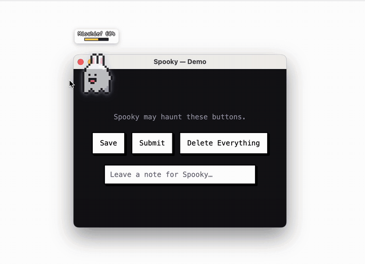

# Spooky

[English](README.md) · **한국어**



데스크톱 위를 떠다니는 픽셀 유령. 커서를 따라다니며 장난 게이지를 채우고, 게이지가 차면 **로컬 오픈 웨이트 모델**이 `BOO`, `EXPLODE`를 고른다.

> Hacktoberfest 2026 _Ghost in the Machine_ 테마로 시작한 개인 프로젝트.
>
> 자세한 내용은 [`docs/PRD.md`](docs/PRD.md).

## 필요 환경

- macOS, Xcode Command Line Tools(`swiftc`)
- Node.js 20.19+
- [Ollama](https://ollama.com) 0.5+

## 모델 준비

Ollama로 로컬에서 모델을 돌린다. `SPOOKY_MODEL`을 지정하지 않으면 [Qwen3 1.7B](https://ollama.com/library/qwen3)(Apache-2.0)를 쓴다.

```bash
ollama pull qwen3:1.7b
ollama serve   # Ollama 앱이 이미 실행 중이면 생략
```

다른 모델을 쓰려면 `SPOOKY_MODEL`에 `ollama list`에 나오는 모델명을 그대로 적는다(예: `qwen3:4b`, `llama3.2:latest`). 자세한 내용은 [`docs/models.md`](docs/models.md).

## 실행

```bash
npm install
npm run dev
npm test
```

메뉴 막대에만 있다(Dock 아이콘 없음). 종료는 **Quit Spooky**. 환경 변수·로그는 [`docs/debugging.md`](docs/debugging.md).

## 설정

메뉴 막대에서 **Mischief Every**(장난 주기), **Ears**(없음 · 토끼 · 고양이 · 곰), **BOO Sounds**, **Mute**를 바꾼다. 설정은 재실행 후에도 남는다.

## React to On-Screen Buttons (선택)

메뉴 막대에서 **React to On-Screen Buttons**를 켜고 macOS 손쉬운 사용 권한을 주면, 커서 근처 다른 앱의 버튼·입력칸·글씨도 대상이 된다. 모델이 고르면 그 위에 폭발을 그리고 글씨를 유령 목소리로 읽는다. 실제 요소는 누르거나 바꾸지 않고, 입력한 값과 비밀번호 칸은 읽지 않는다. 자세한 내용은 [PRD OQ-8](docs/PRD.md#oq-8-상세), 다시 빌드해도 권한을 유지하는 방법은 [`docs/debugging.md`](docs/debugging.md#손쉬운-사용-권한-유지).

## 안전

상태를 바꾸는 폭파는 데모 창 안에서만 일어난다. 다른 앱은 읽기만 하고, 파일은 읽거나 쓰지 않으며, 네트워크는 `127.0.0.1`의 Ollama만 쓴다.

## 라이선스

[MIT](LICENSE)
