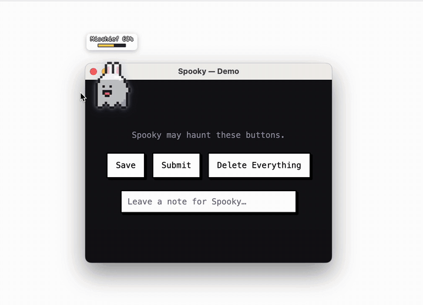

# Spooky

**English** · [한국어](README.ko.md)



A pixel ghost that haunts your desktop. It follows your cursor, charges a mischief gauge,
and when the gauge is full a **local open-weight model** picks `BOO` or `EXPLODE`.

> Started for the Hacktoberfest 2026 _Ghost in the Machine_ theme — now a personal project.
>
> Details in [`docs/PRD.md`](docs/PRD.md).

## Requirements

- macOS, Xcode Command Line Tools (`swiftc`)
- Node.js 20.19+
- [Ollama](https://ollama.com) 0.5+

## Model setup

Spooky runs its model locally through Ollama. Without `SPOOKY_MODEL` it uses [Qwen3 1.7B](https://ollama.com/library/qwen3) (Apache-2.0).

```bash
ollama pull qwen3:1.7b
ollama serve   # skip if the Ollama app is already running
```

To use another model, set `SPOOKY_MODEL` to the exact name `ollama list` shows (e.g. `qwen3:4b`, `llama3.2:latest`). More in [`docs/models.md`](docs/models.md) (Korean).

## Run

```bash
npm install
npm run dev
npm test
```

Spooky lives in the menu bar (no Dock icon). Quit from the menu with **Quit Spooky**. Env vars and logs: [`docs/debugging.md`](docs/debugging.md) (Korean).

## Customize

From the menu bar: **Mischief Every** (how often it acts), **Ears** (none · bunny · cat · bear), **BOO Sounds**, **Mute**. Settings are saved.

## React to On-Screen Buttons (optional)

Turn on **React to On-Screen Buttons** and grant macOS Accessibility permission, and buttons, inputs and text near your cursor in other apps become targets too. If the model picks one, Spooky draws an explosion over it and reads its text aloud in a ghostly voice. The real element is never clicked or changed, and typed values and password fields are never read. Details in [PRD OQ-8](docs/PRD.md#oq-8-상세) (Korean). To keep the permission across rebuilds, see [`docs/debugging.md`](docs/debugging.md#손쉬운-사용-권한-유지).

## Safety

Only Spooky's own demo window is ever changed. Other apps are read-only, your files are never read or written, and the only network connection is to Ollama on `127.0.0.1`.

## License

[MIT](LICENSE)
