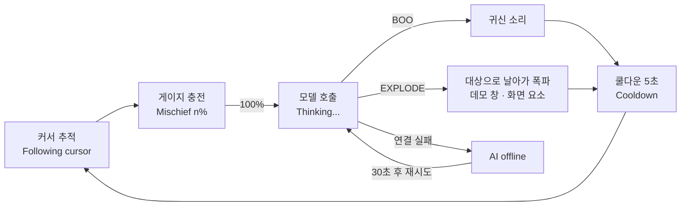
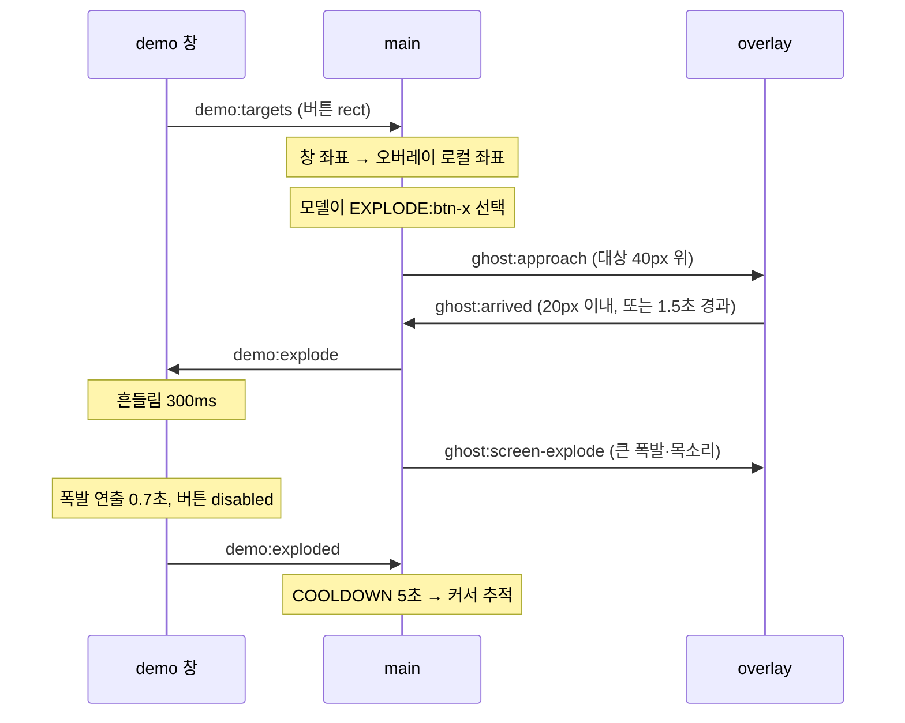

# Spooky — Product Requirements Document

| 항목     | 값                                                    |
| -------- | ----------------------------------------------------- |
| Version  | 0.3.0                                                 |
| Status   | MIN 구현 완료 + 화면 요소(OQ-8)·표정·동물귀·대사 확장 |
| Target   | 개인 프로젝트 (처음 목표는 Hacktoberfest 2026 Week 4) |
| Platform | macOS (Electron)                                      |
| Repo     | GitHub `dusunax/spooky` (private)                     |
| License  | MIT                                                   |
| 작성일   | 최초 2026-10-31 · 마지막 2026-11-07                   |

> 변경 이력은 [§15](#15-변경-이력).

---

## 1. 제품 개요

Spooky는 데스크톱 위를 떠다니는 픽셀 아트 유령 펫이다. 마우스 커서를 일정 거리를 두고 따라다니고, 머리 위 **장난 게이지**가 가득 차면 **로컬 오픈 웨이트 모델(Ollama)** 이 다음 액션을 한 번에 고른다(System 1). 액션은 귀신 소리(BOO)와 폭파(EXPLODE) 두 가지다. 폭파 대상은 자체 데모 창의 버튼·입력칸, 그리고 사용자가 켜면 커서 근처 외부 앱 요소(그림만, OQ-8)다.

- **핵심 콘셉트:** 귀엽지만 조금 성가신, 호기심 많은 어린아이 같은 데스크톱 유령.
- **핵심 메시지:** "이 액션은 스크립트가 아니라 모델이 골랐다" — 그래서 AI 판단 과정을 볼 수 있어야 한다(Observable).

### 1.1 목표

1. 마우스를 따라다니는 투명 오버레이 유령
2. 게이지 기반 자율 행동 루프
3. 오픈 웨이트 모델이 실제로 행동을 결정 (스키마 검증된 JSON)
4. 안전한 액션 — 지금은 상태를 바꾸는 건 자체 데모 창뿐이고, 외부 앱은 읽기 전용 + 그림만이다. 이 범위는 개발 한계 때문에 정한 것이고, 외부 앱 요소에 실제 효과를 주는 것은 확장 목표다([§12](#12-향후-로드맵))
5. 무료·로컬 모델만 쓰되, 다른 엔진을 붙일 수 있게 결정 엔진 계층 분리([§7.5](#75-결정-엔진-계층-확장-대비))

### 1.2 비목표 (전 단계 공통)

- 임의 웹페이지 스크립트 주입
- 사용자 파일·데이터 접근, 입력칸에 입력된 값 읽기
- 장기 기억·학습, 복수 유령, 멀티플레이어, 모바일, 3D
- 캐릭터 커스터마이징
- 유료·클라우드 LLM 호출 (무료 오픈 웨이트 + 로컬 추론만. 유료 엔진은 붙이더라도 명시적 opt-in, [§7.5](#75-결정-엔진-계층-확장-대비))

### 1.3 UX 원칙

| #   | 원칙          | 구체 기준                                                                          |
| --- | ------------- | ---------------------------------------------------------------------------------- |
| 1   | Cute          | 위협적인 표정·소리 금지. BOO 기본 볼륨 30%, 목소리 볼륨 0.35                       |
| 2   | Unpredictable | 동일 입력에서도 행동이 달라질 수 있음 (temperature 0.8, BOO 패턴 랜덤)             |
| 3   | Non-intrusive | 클릭 통과, 커서를 가리지 않음, 포커스를 빼앗지 않음                                |
| 4   | Observable    | 머리 위 상태 텍스트 + 터미널 `[spooky] decision {…}` 로그 ([디버깅](debugging.md)) |
| 5   | Controllable  | 트레이 메뉴 Pause·Mute·Quit, 언제든 종료                                           |

### 1.4 제약과 모델 선택

**출발점: 과제 조건**

DEV Hacktoberfest 2026 Week 4 · _Ghost in the Machine_ 공식 페이지 기준(2026-10-31 확인).

- 기간: 2026-10-26 ~ 2026-10-31 (23:59 PDT 추정)
- 핵심: 오픈소스 AI(오픈 웨이트 모델·오픈소스 하네스·로컬 추론)가 프로젝트를 동작하게 하는 것
- 심사: Writing Quality(가중치 최대) · 주제 적합성 · 창의성 · 기술 완성도 · 파트너 기술 사용(선택)
- 글 템플릿: What I Built / Demo / Code / How I Built It / Why open innovation matters(필수) / My Agent Session·The Spirit of It(선택)

> 제출은 하지 않는다([§15](#15-변경-이력)). "무료·오픈 웨이트·로컬 추론" 원칙은 이 조건에서 나왔고, 그대로 유지한다. 템플릿에 맞춘 글 초안: [`docs/dev-post.md`](dev-post.md)

**후보 비교** (2026-10-31 실측, Apple M4 · 16 GB)

| 후보           | 결과                                                                            | 판단              |
| -------------- | ------------------------------------------------------------------------------- | ----------------- |
| `qwen3:1.7b`   | 16번 중 16번 유효 (BOO 9 · EXPLODE 7)<br>응답 중간값 586ms                      | 채택 (Apache-2.0) |
| `qwen2.5:1.5b` | 12번 중 4번 무효 (EXPLODE를 고르고 대상을 비움)<br>EXPLODE를 고르는 비율도 낮음 | 제외              |
| jev (TypeSafe) | 유료 호스팅                                                                     | 유료이므로 제외   |

**크기·양자화**

| 설정                       | 메모리        | 지연             |
| -------------------------- | ------------- | ---------------- |
| `qwen3:1.7b` Q4_K_M (현재) | 1.9 GB (실측) | p50 586ms (실측) |
| `qwen3:1.7b` Q8_0          | 약 2.7~2.9 GB | 약 1.5배         |
| `qwen3:4b` Q4_K_M          | 약 3.2~3.4 GB | 약 2배           |
| `qwen3:4b` Q8_0            | 약 5.0~5.3 GB | 약 3배           |

메모리는 가중치 + KV 캐시(4096 토큰) + 계산 버퍼다. 현재 설정 외에는 공개된 모델 구조로 계산한 예상값이고, 지연은 가중치 크기에 비례한다고 본 추정이다.

모델이 하는 일은 BOO와 대상 중 하나를 고르고 5단어 이하 대사를 쓰는 것이고, 선택지는 JSON 스키마가 묶는다. 그래서 1초 안에 답하는 1.7B·Q4_K_M을 쓴다. 큰 모델이나 Q8로 바꾸면 주로 대사 품질이 나아질 여지가 있다.

**작은 모델 보완**

- 선택지를 `choice` 한 필드의 `enum`으로 묶는다 ([FR-04](#fr-04-ai-행동-결정--system-1-p0))
- 대상 목록 순서를 매번 섞는다 — 특정 버튼만 터지는 것은 막지만, 섞인 목록의 첫 번째를 고르는 편향은 남는다 ([FR-05](#fr-05-폭파--explode-p0))
- 프롬프트에 예시 문장을 넣지 않는다 — 그대로 베꼈다
- 대사 언어(`lineLanguage`)는 코드가 정한다

**교체:** `SPOOKY_MODEL=<Ollama 태그>`로 실행한다. 예: `SPOOKY_MODEL=qwen3:4b`

---

## 2. 사용자 흐름

기본 장난 주기 20초 기준.



| 시간    | 화면                                      | 상태 텍스트                                                                            |
| ------- | ----------------------------------------- | -------------------------------------------------------------------------------------- |
| 0~10s   | 유령 등장, 커서를 따라다님                | `Following cursor` (게이지 50% 미만)                                                   |
| 10~20s  | 게이지 충전, 80% 이상에서 장난스러운 표정 | `Mischief 50%` …                                                                       |
| 20s~    | 게이지 100%, 점멸 후 멈춤                 | `Thinking...`                                                                          |
| ~1초 후 | 모델 결정 → BOO 또는 EXPLODE              | `Action: BOO` / `Action: EXPLODE → btn-save` / `Action: EXPLODE → that one`(화면 요소) |
| 행동 후 | 부서진 버튼은 그대로, 쿨다운 5초          | `Cooldown`                                                                             |
| 이후    | 다시 추적                                 | `Following cursor`                                                                     |

> 데모 촬영 시에는 `SPOOKY_CHARGE_SECONDS=5`로 시작할 때 충전 시간을 줄인다. 평소에는 사용자가 지정한 시간을 쓰며, 기본값은 20초다.

---

## 3. 스코프 — MIN / TARGET / MAX

### 3.1 MIN — ✅ 구현 완료

| ID     | 기능        | MIN 범위                                                                                                                                                                 |
| ------ | ----------- | ------------------------------------------------------------------------------------------------------------------------------------------------------------------------ |
| FR-01  | 오버레이    | 커서가 있는 디스플레이 전체 크기 투명·프레임 없음·always-on-top·클릭 통과 창 1개                                                                                         |
| FR-02  | 추적        | `screen.getCursorScreenPoint()` 30Hz 폴링, lerp 0.08, 목표 거리 60px, 화면 밖 이동 방지, 커서가 있는 디스플레이로 오버레이 이동                                          |
| FR-03  | 게이지      | 0→100, 기본 20초 충전(트레이에서 변경), 머리 위 48×6px, 쿨다운 중 정지                                                                                                   |
| FR-04  | AI 결정     | Ollama `/api/chat` + `format`(JSON 스키마) + Zod 검증, 파싱 실패 1회 재시도                                                                                              |
| FR-05  | EXPLODE     | 데모 창 버튼 3개 + 입력칸 1개 중 1개: 유령 접근 → 흔들림 → 폭발 → 영구 disabled(Rebuild로만 복구)                                                                        |
| FR-06  | BOO         | Web Audio로 합성한 "우우우~" 5패턴 + 입 벌린 얼굴 + 몸통 팽창                                                                                                            |
| FR-07  | 상태 표시   | 머리 위 한 줄 텍스트 (`Following cursor` / `Mischief n%` / `Thinking...` / `Action: …` / `Cooldown` / `AI offline` / `Paused`)                                           |
| FR-08  | 사용자 제어 | 사용자가 트레이 메뉴에서 고른다([FR-08](#fr-08-사용자-제어--트레이-메뉴-p0)). Dock 아이콘 숨김. 설정은 `userData/settings.json`에 저장                                   |
| 비주얼 | 스프라이트  | 코드 픽셀 매트릭스(16×16 → 4배 확대 64px), 표정 6종([§5.3](#53-표정-매핑-구현-srcspritesexpressionts-2026-11-03)). 레퍼런스 시트 형태 기준. `image-rendering: pixelated` |
| 문서   | 문서        | README(영어) + README.ko.md, [디버깅](debugging.md), MIT LICENSE, [데모 GIF](demo.gif)                                                                                   |

### 3.2 TARGET

| 기능                   | 내용                                                                              | 상태                                                                |
| ---------------------- | --------------------------------------------------------------------------------- | ------------------------------------------------------------------- |
| 스프라이트 시트        | 레퍼런스 시트 기준 PNG, 상태별 2~4프레임 8FPS + 좌우 반전                         | ⏸ 미구현 — 코드 픽셀 표정 6종 + 머리 아이콘 + CSS 움직임으로 대신함 |
| 디버그 패널            | 단축키(`⌘⇧D`) 창: 마지막 입력 컨텍스트, 원본 응답, 검증 결과, 지연 시간, `source` | ⏸ 미구현 — 터미널 로그로 대신함                                     |
| THINKING·COOLDOWN 표현 | 골똘한 얼굴 + `?` / 졸린 얼굴 + `z`                                               | ✅ ([§5.3](#53-표정-매핑-구현-srcspritesexpressionts-2026-11-03))   |
| AI offline UX          | 30초 간격 자동 재연결, 트레이 `Retry AI connection`                               | 🔶 자동 재연결만. 트레이 메뉴 없음                                  |
| 오버레이 폭발 이펙트   | 오버레이에 대상 화면 좌표 기준 폭발 (창 경계를 넘는 폭발)                         | ✅ 데모 창 안 연출 + 오버레이 큰 폭발(BOOM!·그을음)을 함께          |
| 전역 단축키            | `⌘⇧G` Pause/Resume                                                                | ⏸ 미구현                                                            |
| 게이지 연출            | 빈 칸 → 파랑 → 초록 → 노랑 → 주황 → 빨강, 100% 점멸                               | ✅ 5색 단계(25·50·70·90%) + 점멸. 시트의 11단계 그림은 쓰지 않음    |
| 설정 유지              | 재실행 후에도 설정 유지                                                           | ✅ Mute·장난 주기·귀·BOO 패턴·화면 요소. Pause는 저장하지 않음      |
| 대사 필드              | 모델 출력 `line` → 행동 중 말풍선                                                 | ✅ EXPLODE만, 5단어·40자. 유령 목소리로도 읽음(FR-05)               |

**레퍼런스 시트** ([`docs/reference/sprite-sheet.webp`](reference/sprite-sheet.webp), 2026-10-31 사용자 제공)

크기·격자가 균일하지 않은 시안이라 그대로 잘라 쓰지 않고, 상태·형태의 기준으로만 삼는다.

| 분류      | 항목             | 프레임 | FPS |
| --------- | ---------------- | ------ | --- |
| 기본·이동 | IDLE             | 8      | 8   |
|           | MOVE/HAUNT       | 8      | 12  |
|           | TURN             | 4      | –   |
| 감정      | HAPPY            | 4      | –   |
|           | SURPRISE         | 4      | –   |
|           | ANGRY            | 4      | –   |
|           | HURT             | 4      | –   |
|           | THINKING         | 4      | –   |
| 액션      | CHARGING         | 8      | 8   |
|           | BOO              | 6      | 12  |
|           | EXPLODE ACTION   | 8      | 12  |
|           | COOLDOWN         | 6      | 8   |
| UI·이펙트 | GAUGE            | 11     | –   |
|           | BUTTON EXPLOSION | 12     | 12  |

`–`는 시트에 FPS 표기가 없는 항목이다. 그 밖에 EXTRA 아이콘(spark · star · heart · ! · ? · idea · sleep)이 있다.

### 3.3 MAX

| 기능                     | 비고                                        | 상태                                                                                   |
| ------------------------ | ------------------------------------------- | -------------------------------------------------------------------------------------- |
| 7개 상태 전체 애니메이션 | CHARGING 흔들림 등                          | 🔶 CSS 움직임(둥실·떨림·팽창·튀기)만, 프레임 애니메이션 없음                           |
| 멀티 모니터              | 디스플레이 경계에 걸친 연출, 연결·해제 대응 | 🔶 커서가 있는 디스플레이로 오버레이가 옮겨 가고 유령 위치를 이어 감. 경계 연출은 없음 |
| 패키징                   | electron-builder                            | 🔶 `npm run build:mac` → `.app`(`--dir`) + `Spooky Dev` 자체 서명. `.dmg` 없음         |
| 설정 창                  | 추적 속도, 장난 빈도, 크기, 모델 선택       | 🔶 별도 창 없이 트레이 메뉴로 장난 빈도·귀·소리만                                      |
| 행동 추가                | 예: `HIDE`, `SPIN` — 허용 목록 확장 방식만  | ⏸                                                                                      |
| 외부 화면 시각 효과      | 외부 앱 위에 폭발 그림만 (상태 변경 없음)   | ✅ OQ-8로 앞당겨 구현                                                                  |
| 커스터마이징             | 동물귀                                      | ✅ [§5.4](#54-커스텀-동물귀-구현-srcspritesearsts-2026-11-03)                          |

이후 테마(Personality, Haunted Desktop, Autonomous Pet)는 [§12](#12-향후-로드맵) 참조.

### 3.4 시간이 부족할 때 버리는 순서 (보관)

제출 마감용 규칙이었다. 남은 TARGET을 고를 때 우선순위 참고로만 쓴다: 디버그 패널 > 전역 단축키 > 스프라이트 시트. 디버그 패널이 없는 동안에는 터미널 로그(`[spooky] decision {…}`)가 "AI가 실제로 골랐다"의 증거다.

---

## 4. 기능 요구사항 상세

### FR-01. 데스크톱 오버레이 (P0)

| 창        | 역할                                            | 요약                                                 |
| --------- | ----------------------------------------------- | ---------------------------------------------------- |
| `overlay` | 유령·게이지·상태 텍스트·말풍선·폭발 이펙트·소리 | 커서가 있는 디스플레이 전체를 덮는 투명·클릭 통과 창 |
| `demo`    | 폭파 대상 버튼이 있는 일반 창                   | 420×340, 클릭 가능, 로컬 HTML만 로드                 |

`overlay` 창 설정

| 목적                            | 설정                                                                                                     |
| ------------------------------- | -------------------------------------------------------------------------------------------------------- |
| 크기·위치                       | 커서가 있는 디스플레이 `bounds`. 커서가 다른 디스플레이로 가면 `setBounds`                               |
| 투명·테두리 없음                | `transparent`, `frame: false`, `hasShadow: false`                                                        |
| 포커스·클릭을 빼앗지 않음       | `focusable: false`, `setIgnoreMouseEvents(true)`                                                         |
| 항상 위, 모든 데스크톱·풀스크린 | `setAlwaysOnTop(true, 'screen-saver')`, `setVisibleOnAllWorkspaces(true, { visibleOnFullScreen: true })` |
| 가려져도 애니메이션 유지        | `backgroundThrottling: false`                                                                            |
| 클릭 없이 소리 재생             | `autoplayPolicy: 'no-user-gesture-required'`                                                             |

- 작은 창을 30Hz로 `setPosition` 하는 방식은 macOS에서 끊김·그림자 문제가 있어 채택하지 않는다. 전체 화면 오버레이 안에서 CSS `transform`으로 움직인다.
- `getCursorScreenPoint()`는 손쉬운 사용 권한이 필요 없다. 권한은 화면 요소(OQ-8)를 켤 때만 요청한다.

수용 기준

- [x] 유령이 다른 앱(풀스크린 포함) 위에 보인다.
- [x] 유령·게이지 아래의 버튼·링크가 정상 클릭된다.
- [x] 트레이 Quit으로 모든 창·타이머·진행 중 요청이 정리되고 종료된다.

### FR-02. 마우스 추적 (P0)

| 항목           | 기본값                                                                       |
| -------------- | ---------------------------------------------------------------------------- |
| 커서 폴링      | 30Hz (main) → overlay로 IPC                                                  |
| 렌더           | rAF, lerp 계수 0.08 (실제 프레임 간격으로 보정)                              |
| 목표 거리      | 커서에서 60px 떨어진 지점 (커서의 좌상단 방향 기본, 이동 방향에 따라 반대편) |
| 정지 임계값    | 목표점과 8px 이내면 정지                                                     |
| 화면 경계      | 유령 박스(머리 위 상태 패널 54px 포함)가 디스플레이 밖으로 나가지 않게 clamp |
| 접근(APPROACH) | 폭파 대상 40px 위로 lerp 0.2, 20px 이내면 도착                               |

- 유령 중심이 커서 반경 48px 안에 들어오지 않게 한다(시야 가림 방지).
- 커서 속도(px/s)는 최근 0.5초 이동량으로 계산해 AI 입력에 쓴다.

### FR-03. 장난 게이지 (P0)

| 항목                | 기본값                                                                                                                                        |
| ------------------- | --------------------------------------------------------------------------------------------------------------------------------------------- |
| 범위                | 0~100                                                                                                                                         |
| 충전                | 기본 20초에 100. 트레이 **Mischief Every**에서 10초·20초·40초·1.5분·3분 선택(저장됨, 바로 적용). `SPOOKY_CHARGE_SECONDS`는 시작할 때만 덮어씀 |
| 100 도달            | 충전 정지 → THINKING, AI 요청 1회                                                                                                             |
| 행동 완료           | 0으로 초기화 → COOLDOWN 5초 (충전 정지). 완료 신호가 10초 안에 안 오면 강제로 완료                                                            |
| PAUSED / AI_OFFLINE | 충전 정지 (AI_OFFLINE은 100에서 대기, 30초마다 다시 물음)                                                                                     |

### FR-04. AI 행동 결정 — System 1 (P0)

**정의:** 짧은 컨텍스트 1회 호출로, 숙고 없이 즉시 하나의 행동을 고른다. 체인·도구 호출·재귀 없음. 모델의 thinking 모드는 끈다.

**입력 컨텍스트** (`electron/ai/schema.ts`, `context.ts`)

```ts
type DecisionContext = {
  cursorSpeed: 'still' | 'slow' | 'fast' // 수치 대신 버킷 — 소형 모델이 덜 헷갈림
  distanceToCursor: number // px, 정수
  lastAction: 'BOO' | 'EXPLODE' | null
  secondsSinceLastAction: number | null
  targets: { id: string; label: string }[] // 데모 창의 남은 버튼·입력칸 + 화면 요소(screen-target), 매번 순서를 섞음
  lineLanguage: 'Korean' | 'English' // 대상 글씨에 한글이 있으면 Korean — 코드가 정한다
}
```

**출력 스키마** (Ollama `format`에 JSON 스키마로 전달 + Zod로 재검증)

모델 출력은 `{ choice, intensity, line }`이다. `choice`는 `"BOO"` 또는 `"EXPLODE:<targetId>"` 중 하나이고, 선택지 목록은 호출마다 현재 targets로 만들어 JSON 스키마 `enum`에 넣는다. 검증을 통과하면 내부 `GhostAction`으로 바꾼다.

```ts
// 모델 출력
{ choice: 'BOO' | `EXPLODE:${targetId}`, intensity: number, line: string }
// 내부 행동 (src/shared/ipc.ts)
type GhostAction = { type: 'BOO'; intensity: number } | { type: 'EXPLODE'; targetId: string }
type Decision = { action: GhostAction; source: 'model' | 'fallback' | 'debug'; line?: string }
// 검증: BOO는 0 ≤ intensity ≤ 1, EXPLODE는 targetId ∈ context.targets
// line: EXPLODE일 때만 쓴다. 이모지·따옴표 제거 → 첫 문장만 → 5단어·40자 안에서 단어 경계로 자름. BOO는 대사 없음
```

> 왜 한 필드인가 (2026-10-31 실측): `{type, intensity, targetId}` 세 필드로 두면 qwen2.5:1.5b는 EXPLODE를 고르고 targetId를 비워 4/12가 무효였고, qwen3:1.7b는 12/12 모두 BOO 0.5만 골랐다. 선택지를 한 필드로 합치자 qwen3:1.7b가 16/16 유효, BOO 9·EXPLODE 7로 고르게 섞였다.

**결정 기록** (로그, `electron/ai/decide.ts`)

```ts
type DecisionRecord = {
  context: DecisionContext
  raw: string | null
  action: GhostAction
  line: string
  engine: string // 엔진 label, 예: 'ollama/qwen3:1.7b' (§7.5)
  source: 'model' | 'fallback' | 'debug'
  fallbackReason?: 'parse_failed' | 'invalid_target'
  latencyMs: number
}
```

로그에 남길 때는 화면 요소 라벨을 `[on-screen element]`로 가린다(`redactRecord`).

**호출 파라미터**

| 항목        | 값                                                                                                                              |
| ----------- | ------------------------------------------------------------------------------------------------------------------------------- |
| Endpoint    | `http://127.0.0.1:11434/api/chat`, `stream:false`                                                                               |
| Model       | `qwen3:1.7b` (Apache-2.0, Q4_K_M 1.4GB). p50 586ms. 환경변수 `SPOOKY_MODEL`로 교체 가능. 선택 근거 [§1.4](#14-제약과-모델-선택) |
| temperature | 0.8                                                                                                                             |
| think       | false                                                                                                                           |
| keep_alive  | 30m                                                                                                                             |
| Timeout     | 10초 (넘으면 AI_OFFLINE)                                                                                                        |
| 호출 위치   | Electron main (renderer는 결과만 받음)                                                                                          |

**System prompt** (`electron/ai/prompt.ts`의 `SYSTEM_PROMPT`)

```text
You are the instinctive brain of a mischievous but cute desktop ghost.
You talk like a curious little kid: wide-eyed, full of questions, easily amazed.
Pick exactly one playful action right now. Do not explain.

Actions:
- BOO: make a cute ghost sound. intensity 0.0 (whisper) to 1.0 (loud).
- EXPLODE: playfully explode one target (a button, input, text or icon).

Rules:
- choice is "BOO" or "EXPLODE:<targetId>". intensity is used only for BOO.
- Only choose EXPLODE if targets is not empty.
- Prefer a different action than lastAction, but surprise is allowed.
- If the cursor is fast, the user is busy: prefer a small BOO.
- line: only for EXPLODE — one very short remark (max 5 words) in that curious-kid voice. For BOO, leave line empty.
  If you explode a target, use words from its label in the line.
  Vary it every time: wonder, a question, a giggle, a tiny dare.
  Write the line in lineLanguage. For Korean, use casual kid-like 반말. No emoji.
```

**User 메시지:** 프롬프트 없이 `DecisionContext` JSON만 넣는다.

> 출력 형식 지시는 `format` 스키마가 강제하므로 프롬프트에서 뺀다. 안전 규칙은 모델이 지킬 수 있는 영역이 아니라 **허용 목록·검증 코드가 보장**하므로 [§9](#9-비기능-요구사항)에 둔다. 프롬프트에 예시 문장을 넣지 않는다 — 소형 모델이 그대로 베낀다(실측).

**디버그 모드:** `SPOOKY_DEBUG_SCREEN_TARGET=1`이면 모델 없이 화면 요소를 고른다(`source:'debug'`). 자세한 내용은 [`debugging.md`](debugging.md#화면-요소-강제-모드).

### FR-05. 폭파 — EXPLODE (P0)

**데모 창 구성:** 버튼 3개 — `Save`, `Submit`, `Delete Everything`(장난용 문구, 실제 동작 없음) + 입력칸 1개(`input-note`, 라벨 `Note input`). 각 요소에 `data-ghost-target="btn-save"` 등 id.

**데모 창 흐름**



1. demo renderer → main: `demo:targets` — `{ id, label, rect, disabled }[]` (창 로드·리사이즈·버튼 상태 변경 시. 창 이동은 main이 창 좌표로 매번 보정)
2. main: `demoWin.getContentBounds()`로 화면 좌표 변환 → overlay 디스플레이 원점 기준 로컬 좌표로 변환
3. main → overlay: `ghost:approach { x, y }` (대상 40px 위)
4. overlay 도착(20px 이내) 또는 1.5초 경과 → main → demo: `demo:explode { id }`
5. demo: 흔들림 300ms → 그을린 스타일 + 섬광·파편·연기 → `disabled` → 연출(0.7초) 끝에 `demo:exploded { id }`. 흔들림이 끝나는 시점에 오버레이에도 큰 폭발(`ghost:screen-explode`)을 그린다
6. main: COOLDOWN 진입, 유령은 다시 커서 추적. **부서진 버튼은 돌아오지 않는다** (2026-10-31 사용자 결정). 데모 창의 Rebuild 버튼이나 트레이 `Rebuild Demo Buttons`(`demo:reset`)로만 되살린다. 모두 부서지면 대상이 비어 모델은 BOO만 고를 수 있다

대상 목록은 호출마다 순서를 섞어 모델에 넘긴다. 섞지 않았을 때 qwen3:1.7b가 목록 맨 앞(`btn-save`)만 3/3 골랐다(2026-10-31).

섞어도 위치 편향은 남는다. 대상 4개를 섞어 40회 호출하자 EXPLODE 40회 중 첫 번째 28회(70%), 두 번째 6회, 세 번째 1회, 네 번째 5회를 골랐다(2026-11-07, 직전 액션 BOO). 섞기는 특정 버튼 편향을 없앨 뿐이고, 대상 선택의 상당 부분은 섞인 순서가 정한다.

**화면 요소 흐름** (OQ-8, 트레이에서 켰을 때만)

1. 판단 직전 Swift 도우미(`native/ax-probe.swift`)가 커서 반경 120px 안에서 가장 가까운 요소를 찾아 `screen-target`으로 대상에 넣는다
2. 모델이 고르면 유령이 요소에서 커서에 가장 가까운 점(`spotFor`) 40px 위로 날아간다
3. 도착하면 오버레이가 폭발·그을음을 그리고, **동시에** 유령 목소리로 `"<라벨>? <line>"`을 읽는다. 목소리가 0.5초 안에 준비되지 않으면 목소리 없이 터뜨린다
4. 둘 다 끝나면 `ghost:screen-done` → COOLDOWN. 실제 요소는 건드리지 않는다

데모 창 대상도 `line`이 있으면 같은 목소리로 읽는다. Mute면 목소리를 만들지 않는다.

예외

- 데모 창이 닫혀 있음 / 최소화 / 다른 디스플레이 → `targets`에서 제외 → 모델이 EXPLODE를 고를 수 없음
- 모델이 없는 id를 반환 → BOO(intensity 0.5) 폴백, `source:'fallback'`, `fallbackReason:'invalid_target'`
- 날아가는 사이 대상이 사라짐 → 행동을 끝내고 COOLDOWN
- 데모 창을 닫았다 다시 열면 버튼도 새로 만들어진다

### FR-06. 귀신 소리 — BOO (P0)

오디오 파일 없이 코드로 만든 소리다. 패턴은 5가지:

| 패턴     | 소리                       | 기본 길이 |
| -------- | -------------------------- | --------- |
| wail     | 우우우~ 길게 내려감        | 1.2초     |
| question | 우우~? 끝이 올라감         | 1.0초     |
| stutter  | 우, 우, 우우~ 끊어서 세 번 | 1.1초     |
| moan     | 우우우… 낮고 느림, 떨림    | 1.5초     |
| warble   | 우워워워~ 크게 흔들림      | 1.1초     |

- 트레이 **BOO Sounds**에서 켠 패턴 중 랜덤으로 고르고, 직전 패턴은 피한다
- 모델이 정한 intensity가 클수록 소리가 크고 길다 (최대 1.5배). 기본 볼륨은 30%
- Mute면 소리 없이 같은 시간 동안 애니메이션만 재생
- 사운드 종료 → `ghost:boo-ended` → COOLDOWN

### FR-07. 상태 표시 (P0)

머리 위 상태 텍스트는 게이지 바로 위, 픽셀 폰트, 흰 글자 + 검은 외곽선. EXPLODE 중 `line`이 있으면 말풍선으로 보인다. 화면 요소의 라벨은 상태 텍스트에 쓰지 않고 `that one`으로 표시한다.

### FR-08. 사용자 제어 — 트레이 메뉴 (P0)

사용자가 메뉴 막대의 Spooky 아이콘을 눌러 직접 고르는 항목이다. 설정 항목은 저장돼 재실행 후에도 유지된다.

| 메뉴                       | 동작                                                                                                                            |
| -------------------------- | ------------------------------------------------------------------------------------------------------------------------------- |
| Pause / Resume             | 추적·충전·AI 호출 모두 정지, 유령은 제자리에서 반투명                                                                           |
| Mute / Unmute              | BOO 소리와 유령 목소리를 끔                                                                                                     |
| Mischief Every             | 장난 주기 10초·20초·40초·1.5분·3분                                                                                              |
| Ears                       | None·Bunny·Cat·Bear ([§5.4](#54-커스텀-동물귀-구현-srcspritesearsts-2026-11-03))                                                |
| BOO Sounds                 | BOO 패턴 5종 체크박스. 켠 패턴 중 랜덤(직전 패턴 제외), 켤 때 미리듣기, 최소 1개 유지                                           |
| React to On-Screen Buttons | 화면 요소 대상 켜기/끄기(기본 꺼짐). 켤 때 권한이 없으면 손쉬운 사용 허용 창. 권한이 없으면 라벨에 안내, 도우미가 없으면 비활성 |
| Show Demo Window           | 데모 창 열기/앞으로                                                                                                             |
| Rebuild Demo Buttons       | 부서진 데모 버튼 되살리기                                                                                                       |
| Test Ghost Voice           | 영어·한국어 샘플을 번갈아 유령 목소리로 재생 (권한 없이 목소리만 확인)                                                          |
| Quit Spooky (`⌘Q`)         | 진행 중 요청 abort, 타이머·도우미·IPC 정리 후 종료                                                                              |

---

## 5. 상태 머신

상태 머신을 **두 레이어**로 나눈다. 렌더링 표정은 두 레이어 조합으로 결정한다.

### 5.1 Movement 레이어 (overlay `useFollow`)

| 상태       | 설명                                          | 전이                                      |
| ---------- | --------------------------------------------- | ----------------------------------------- |
| `FOLLOW`   | 커서 추적 (HAUNT)                             | Mischief가 `ACTING(EXPLODE)` → `APPROACH` |
| `APPROACH` | 대상으로 이동                                 | 도착 또는 1.5초 → `HOLD`                  |
| `HOLD`     | 제자리 (BOO 중, EXPLODE 중, THINKING, PAUSED) | 행동 종료 → `FOLLOW`                      |

### 5.2 Mischief 레이어 (main `mischief.ts`)

```ts
type MischiefState =
  | 'CHARGING' // 게이지 충전 중
  | 'THINKING' // AI 요청 중
  | 'ACTING' // BOO 또는 EXPLODE 실행 중
  | 'COOLDOWN' // 5초, 충전 정지
  | 'AI_OFFLINE' // Ollama 연결 불가, 게이지 100에서 대기
  | 'PAUSED' // 사용자 일시정지
```

| 현재       | 조건                                  | 다음                                                                                                  |
| ---------- | ------------------------------------- | ----------------------------------------------------------------------------------------------------- |
| CHARGING   | gauge = 100                           | THINKING                                                                                              |
| CHARGING   | 시작 헬스체크 실패                    | AI_OFFLINE                                                                                            |
| THINKING   | 유효한 결정(모델·폴백·디버그)         | ACTING                                                                                                |
| THINKING   | 연결 실패 / 모델 없음 / 타임아웃      | AI_OFFLINE                                                                                            |
| ACTING     | BOO 종료 / 폭파 연출 종료 / 10초 경과 | COOLDOWN                                                                                              |
| COOLDOWN   | 5초                                   | CHARGING (gauge 0)                                                                                    |
| AI_OFFLINE | 30초                                  | THINKING (다시 물음)                                                                                  |
| (any)      | Pause                                 | PAUSED (이전 상태 기억, 진행 중 요청 abort)                                                           |
| PAUSED     | Resume                                | THINKING·AI_OFFLINE이었으면 THINKING, ACTING·COOLDOWN이었으면 COOLDOWN, 그 밖은 CHARGING (gauge 유지) |

행동마다 `actionId`를 1씩 올려 렌더러가 같은 행동을 두 번 실행하지 않게 한다.

### 5.3 표정 매핑 (구현: `src/sprites/expression.ts`, 2026-11-03)

표정은 얼굴 없는 몸통 위에 점을 찍어 만든다(`src/sprites/ghost.ts`).

| 조건                 | 표정                 | 머리 옆 아이콘 | 움직임        |
| -------------------- | -------------------- | -------------- | ------------- |
| CHARGING, gauge < 80 | 웃는 얼굴            | –              | 둥실둥실      |
| CHARGING, gauge ≥ 80 | 장난기(눈썹·씩 웃음) | –              | 부들부들 떨림 |
| THINKING             | 골똘히(위를 보는 눈) | `?`            | 멈춤          |
| ACTING(BOO)          | 입 크게              | –              | 몸통 팽창     |
| ACTING(EXPLODE)      | 신남(^ ^ 눈)         | 반짝           | 통통 튀기     |
| COOLDOWN             | 졸림(감은 눈)        | `z`            | 느리게 둥실   |
| AI_OFFLINE           | 졸림                 | `zzz`          | 느리게 둥실   |
| PAUSED               | 웃는 얼굴            | –              | 반투명        |

### 5.4 커스텀 동물귀 (구현: `src/sprites/ears.ts`, 2026-11-03)

트레이 **Ears ▸ None / Bunny / Cat / Bear**에서 고르고 설정에 저장한다. 귀는 몸통 위에 덮어 그려 귀 안쪽 흰색이 몸통과 이어지고, 모든 표정에 적용된다. 귀가 있으면 유령이 위로 16px(4행) 커지고 상태 패널도 그만큼 올라간다. 앱·트레이 아이콘에는 귀를 붙이지 않는다.

| 귀    | 모양                                                                     |
| ----- | ------------------------------------------------------------------------ |
| Bunny | 가운데로 모은 작은 귀, 분홍 3칸, 그림자 없음                             |
| Cat   | 머리 옆선이 귀 끝까지 곧게, 가운데 V자 홈, 흰 끝 아래 바깥쪽 세모 그림자 |
| Bear  | 머리 위 모서리의 작고 둥근 귀, 왼쪽 아래 그림자                          |

---

## 6. AI 실패 처리

원칙: **모델에 닿지 못하면 액션을 멈춘다. 모델이 응답했는데 쓸 수 없으면 BOO로 폴백한다.** 폴백은 `source:'fallback'`으로 기록해 "AI가 골랐다"고 표시하지 않는다.

| 상황                      | 처리                                                                    | 상태 텍스트              |
| ------------------------- | ----------------------------------------------------------------------- | ------------------------ |
| Ollama 미실행 (연결 거부) | AI_OFFLINE, 자동 액션 중지, 30초 간격 재시도                            | `AI offline`             |
| 모델 미설치 (404)         | AI_OFFLINE, 30초 간격 재시도. 설치 방법은 README에                      | `Model missing`          |
| 타임아웃 10초             | AI_OFFLINE과 동일 처리                                                  | `AI offline`             |
| 응답 파싱·스키마 실패     | 1회 재시도 → 또 실패 시 BOO(0.5) 폴백                                   | `Action: BOO (fallback)` |
| 존재하지 않는 targetId    | 재시도 없이 BOO(0.5) 폴백                                               | `Action: BOO (fallback)` |
| 대상 없음                 | targets가 빈 배열 → 스키마 `enum`이 `BOO`만 허용                        | —                        |
| 추론 지연                 | THINKING 유지 (렌더·추적은 계속)                                        | `Thinking...`            |
| 화면 요소 탐색 실패       | 도우미 응답 1.5초 제한, 못 찾거나 권한이 없으면 그 요소만 대상에서 빠짐 | —                        |
| 앱 종료                   | AbortController로 요청 취소, 타이머·도우미 정리                         | —                        |

시작 시 헬스체크: `GET /api/tags`로 서버·모델 존재 확인 → 없으면 처음부터 AI_OFFLINE으로 시작해 게이지가 의미 없이 차지 않게 한다.

---

## 7. 기술 아키텍처

### 7.1 스택

| 영역        | 선택                                              | 비고                                                            |
| ----------- | ------------------------------------------------- | --------------------------------------------------------------- |
| Desktop     | Electron 44                                       | Node 20.19+                                                     |
| Build       | electron-vite 6 (Vite 8)                          |                                                                 |
| UI          | React 19 + TypeScript                             |                                                                 |
| State       | main이 상태 소유, 렌더러는 React state + ref      |                                                                 |
| Styling     | plain CSS                                         | 글래스모피즘 몸통(불투명도 0.9)                                 |
| Sprite      | 코드 픽셀 매트릭스                                | `scripts/make-icons.py`가 같은 프레임으로 앱·트레이 아이콘 생성 |
| Audio       | Web Audio API                                     | BOO 합성, 목소리 효과                                           |
| Voice       | macOS `say` (영어 Junior·한글 Yuna) → WAV         | 임시 파일은 바로 삭제                                           |
| AI          | Ollama REST (fetch)                               | SDK 없이 직접 호출                                              |
| Validation  | Zod 4                                             | 설정 파일도 검증                                                |
| Native      | Swift 도우미 `ax-probe` (손쉬운 사용 API)         | `scripts/build-native.mjs`가 `swiftc`로 빌드                    |
| Lint/Format | ESLint 9 + Prettier                               |                                                                 |
| Test        | Vitest 4                                          | 상태 머신·스키마·결정 정책·문구 자르기·좌표·표정·귀             |
| 패키징      | electron-builder `--dir` + `scripts/sign-mac.mjs` | `Spooky Dev` 인증서가 있으면 그걸로, 없으면 ad-hoc 서명         |

### 7.2 프로세스 책임

| 프로세스         | 책임                                                                                                                                |
| ---------------- | ----------------------------------------------------------------------------------------------------------------------------------- |
| main             | 창 생성, 커서 폴링, 게이지·Mischief 상태의 **단일 진실 공급원**, Ollama 호출, 화면 요소 탐색, 목소리 합성, 트레이, 설정, IPC 라우팅 |
| overlay renderer | 유령 렌더, lerp 이동, 게이지·상태 텍스트·말풍선, 폭발 이펙트, BOO·목소리 재생                                                       |
| demo renderer    | 버튼 렌더, 버튼 rect 보고, 폭파 연출, Rebuild                                                                                       |
| preload          | `contextBridge`로 채널 화이트리스트만 노출                                                                                          |
| `ax-probe`       | stdin/stdout JSON으로 커서 근처 요소의 종류·라벨·위치만 읽음 (읽기 전용)                                                            |

게이지·상태를 main이 소유하는 이유: overlay가 숨겨지거나 리로드돼도 상태가 유지되고, AI 호출 중복을 main 한 곳에서 막을 수 있다.

### 7.3 IPC 채널 (화이트리스트, `src/shared/ipc.ts`)

| 채널                   | 방향           | 페이로드                                                         |
| ---------------------- | -------------- | ---------------------------------------------------------------- |
| `cursor:update`        | main → overlay | `{ x, y, speed, origin }` (오버레이 로컬 좌표 + 디스플레이 원점) |
| `ghost:state`          | main → overlay | `{ mischief, gauge, statusText, decision, actionId }`            |
| `ghost:settings`       | main → overlay | `{ muted, booPatterns, screenButtons, chargeSeconds, ears }`     |
| `ghost:preview-boo`    | main → overlay | `{ pattern }`                                                    |
| `ghost:approach`       | main → overlay | `{ x, y }`                                                       |
| `ghost:screen-explode` | main → overlay | `{ x, y, width, height, voice: Uint8Array \| null }`             |
| `ghost:play-voice`     | main → overlay | `{ voice }` (Test Ghost Voice)                                   |
| `ghost:position`       | overlay → main | `{ x, y }` (AI 컨텍스트의 커서 거리용)                           |
| `ghost:arrived`        | overlay → main | `{}`                                                             |
| `ghost:boo-ended`      | overlay → main | `{}`                                                             |
| `ghost:screen-done`    | overlay → main | `{}` (폭발·목소리 연출 끝)                                       |
| `demo:targets`         | demo → main    | `{ id, label, rect, disabled }[]`                                |
| `demo:explode`         | main → demo    | `{ id }`                                                         |
| `demo:exploded`        | demo → main    | `{ id }`                                                         |
| `demo:reset`           | main → demo    | `{}` (Rebuild Demo Buttons)                                      |

### 7.4 디렉터리

```text
spooky/
├── electron/
│   ├── main.ts            # 앱 수명주기, 배선
│   ├── windows.ts         # overlay / demo 창 설정
│   ├── cursor.ts          # 커서 폴링 + 속도 + 디스플레이 이동
│   ├── mischief.ts        # 게이지 + Mischief 상태 머신
│   ├── demo-targets.ts    # 데모 창 버튼 좌표 → 오버레이 좌표
│   ├── screen-buttons.ts  # ax-probe 도우미 프로세스와 대화
│   ├── screen-target.ts   # 화면 요소 → 대상(screen-target), 좌표, 로그 가림
│   ├── explode.ts         # 접근 → 폭파 → 목소리 흐름
│   ├── voice.ts           # macOS say → WAV
│   ├── spoken-text.ts     # 읽을 글씨 4단어·30자 자르기
│   ├── settings.ts        # userData/settings.json (Zod)
│   ├── tray.ts
│   ├── preload.ts
│   └── ai/
│       ├── decide.ts      # 검증 + 재시도 + 폴백 + DecisionRecord (엔진 무관)
│       ├── schema.ts      # DecisionContext·출력 Zod + JSON 스키마 + line 정리
│       ├── context.ts     # 커서·대상 → DecisionContext
│       ├── prompt.ts      # 시스템 프롬프트
│       └── engines/
│           ├── types.ts   # DecisionEngine 인터페이스
│           └── ollama.ts  # 헬스체크, chat 호출, abort
├── native/ax-probe.swift  # 손쉬운 사용 읽기 전용 도우미
├── scripts/               # build-native, sign-mac, make-icons
├── src/
│   ├── overlay/           # Overlay, GhostSprite, PixelArt, MischiefGauge, useFollow, useBoo …
│   ├── demo/              # Demo (버튼·입력칸, 폭파 연출, Rebuild)
│   ├── effects/           # Explosion (데모·오버레이 공용)
│   ├── audio/             # boo, ghostVoice, context
│   ├── sprites/           # ghost(프레임·팔레트), expression, ears
│   └── shared/            # ipc(채널 계약), boo-patterns
├── resources/             # 트레이 아이콘, (빌드 산출) bin/ax-probe
├── build/                 # 앱 아이콘
├── docs/PRD.md, docs/reference/
├── README.md, README.ko.md, LICENSE
└── package.json
```

`*.test.ts`는 각 모듈 옆에 둔다.

### 7.5 결정 엔진 계층 (확장 대비)

Ollama 엔진 하나만 구현하지만, 다른 로컬 런타임·룰 엔진·(opt-in) 유료 엔진을 붙일 때 **`engines/`에 파일 하나만 추가**하면 되도록 경계를 나눈다.

```ts
// electron/ai/engines/types.ts
interface DecisionEngine {
  id: string // 'ollama' | ...
  kind: 'open-local' | 'hosted'
  label: string // 로그 표시용, 예: 'ollama/qwen3:1.7b'
  health(): Promise<'ok' | 'offline' | 'model_missing'>
  decide(ctx: DecisionContext, signal: AbortSignal): Promise<{ raw: string }>
}
// 모델에 닿지 못하면 EngineUnavailableError('offline' | 'model_missing')를 던진다
```

| 계층                      | 아는 것                                                         | 모르는 것                |
| ------------------------- | --------------------------------------------------------------- | ------------------------ |
| `mischief.ts` (상태 머신) | `decide(signal)` → `DecideResult`                               | 어떤 엔진·모델인지       |
| `decide.ts`               | Zod 검증, targetId 검증, 재시도, 폴백, `source` 기록, 지연 측정 | HTTP·프롬프트 세부       |
| `engines/*`               | 각 런타임의 호출 방식                                           | 상태 머신, 폴백 정책, UI |

규칙

- 검증·폴백·`source` 기록은 `decide.ts` 한 곳에만 둔다. 엔진이 바뀌어도 안전 보장은 그대로다.
- 엔진은 지금 `main.ts`에서 Ollama로 고정한다. 두 번째 엔진을 붙일 때 `SPOOKY_ENGINE` 환경변수(기본 `ollama`)로 고르게 한다.
- 유료(`kind:'hosted'`) 엔진은 기본값이 될 수 없고, 명시적 opt-in + 비용 상한을 둔다.

---

## 8. UI 규격

| 요소        | 규격                                                                                                                                                                             |
| ----------- | -------------------------------------------------------------------------------------------------------------------------------------------------------------------------------- |
| 유령        | 표시 64×64px(16×16 ×4), nearest-neighbor, 반투명 흰 몸통(글래스모피즘, 0.9) + 진회색 외곽선 + 오른쪽에 몰린 점눈 + 분홍 입 + 물결 하단 + 왼쪽 아래 그림자. 귀가 있으면 위로 16px |
| 게이지      | 유령 상단 중앙, 48×6px, 1px 검은 외곽선, 5색 단계, 100% 점멸                                                                                                                     |
| 상태 텍스트 | 게이지 위, 픽셀 폰트, 흰 글자 + 검은 외곽선(text-shadow)                                                                                                                         |
| 말풍선      | EXPLODE 중 `line`                                                                                                                                                                |
| 폭발        | 데모 창 안 연출 + 오버레이 큰 폭발(BOOM!)·그을음. 그을음은 대상 크기를 따르되 최대 360×120                                                                                       |
| 애니메이션  | CSS 움직임(둥실·떨림·팽창·튀기), 이동은 rAF                                                                                                                                      |
| 데모 창     | 420×340px, 버튼 3개 + 입력칸 1개, 다크 배경 (유령의 흰색이 잘 보이도록)                                                                                                          |

---

## 9. 비기능 요구사항

| 영역   | 기준                                                                                                                                                                                                         |
| ------ | ------------------------------------------------------------------------------------------------------------------------------------------------------------------------------------------------------------ |
| 성능   | 오버레이 렌더 30FPS 이상, AI 추론 중에도 추적이 멈추지 않음, AI 호출은 게이지 사이클당 최대 2회(재시도 포함). 화면 요소 탐색은 보통 2~80ms                                                                   |
| 리소스 | 유휴 시 CPU 5% 이하 목표 (Apple M4 · 16 GB 기준), 모델은 Ollama keep-alive 30분                                                                                                                              |
| 보안   | `contextIsolation:true`, `nodeIntegration:false`, `sandbox:true`, IPC 화이트리스트, 원격 URL 로드·창 이동 금지(로컬 파일만), Ollama는 `127.0.0.1`만                                                          |
| 안전   | 행동은 허용 목록(BOO·EXPLODE)만, targetId는 데모 창이 보고한 id와 `screen-target`만. 외부 앱은 읽기 전용(누르기·값 변경 API 없음), 입력값·비밀번호 칸은 읽지 않음, 화면 글씨는 로그에서 가림, 파일 접근 없음 |
| 권한   | 손쉬운 사용 권한은 화면 요소를 켤 때만. `Spooky Dev` 자체 서명 인증서로 빌드하면 다시 빌드해도 권한 유지                                                                                                     |
| 사용성 | 클릭 통과, 커서 가림 방지, 화면 밖 이동 방지, 종료 수단 항상 노출, 기본 볼륨 30%                                                                                                                             |

---

## 10. 완료 기준 (Definition of Done — MIN 기준)

- [x] `npm install && npm run dev`로 실행된다 (README 그대로 따라 했을 때)
- [x] 데스크톱 위에 픽셀 유령이 보이고 커서를 따라다닌다
- [x] 유령 아래를 클릭해도 아래 앱이 정상 반응한다
- [x] 게이지가 자동 충전되고, 100에서 **실제 Ollama 호출**이 일어난다 (로그로 확인)
- [x] 모델 결정으로 BOO와 EXPLODE가 **각각 1회 이상** 실행된 것을 확인했다 (`source:'model'`)
- [x] EXPLODE된 버튼은 부서진 채 남고, Rebuild로 모두 되살아난다
- [x] Ollama에 닿지 못하면 크래시 없이 `AI offline`으로 동작한다 (상태 머신·결정 정책 테스트)
- [x] 트레이에서 Pause·Mute·Quit이 동작한다
- [x] 5분 연속 실행 중 크래시 없음
- [x] 데모 GIF ([`docs/demo.gif`](demo.gif))
- [ ] GitHub public 전환 (OQ-2, 사용자 확인 후)
- ~~DEV 챌린지 제출 글 게시~~ — 제출하지 않음 (2026-11-03)

---

## 11. Open Questions

| ID   | 질문                                                                  | 결정                                                                                                                                      | 상태                       |
| ---- | --------------------------------------------------------------------- | ----------------------------------------------------------------------------------------------------------------------------------------- | -------------------------- |
| OQ-1 | DEV 챌린지 Week 4 제출 마감 일시                                      | 2026-10-31 23:59 PDT로 확인했으나, **제출하지 않기로 함 (2026-11-03)**                                                                    | 종료                       |
| OQ-2 | 레포 위치·이름·GitHub 공개 시점                                       | GitHub `dusunax/spooky`. 지금은 private, 공개는 사용자 확인 후                                                                            | ✅ 확정 (공개 시점만 보류) |
| OQ-3 | 레퍼런스 이미지를 레포에 넣을지, 그 이미지로 스프라이트를 직접 그릴지 | 레포에 넣고(`docs/reference/`), 코드 픽셀로 레퍼런스 형태를 따라 그림. PNG 시트는 TARGET(미구현)                                          | ✅ 확정 (2026-10-31)       |
| OQ-4 | 모델 확정                                                             | **무료·오픈 웨이트만**: Ollama 로컬 `qwen3:1.7b`. 근거는 [§1.4](#14-제약과-모델-선택)                                                     | ✅ 확정 (2026-10-31)       |
| OQ-5 | Ollama 미연결 시 정책                                                 | 자동 액션 중지([§6](#6-ai-실패-처리)). "폴백이 아니라 진짜 모델 결정"을 보장하기 위함                                                     | ✅ 확정 (2026-10-31)       |
| OQ-6 | 오버레이 방식                                                         | 전체 화면 클릭 통과 창 1개 + 데모 창 분리([§4](#4-기능-요구사항-상세) FR-01)                                                              | ✅ 확정 (2026-10-31)       |
| OQ-7 | EXPLODE 대상 범위                                                     | 상태를 바꾸는 폭파는 자체 데모 창 버튼·입력칸만. 외부 화면은 그림만 — OQ-8로 확장                                                         | ✅ 확정 (2026-10-31)       |
| OQ-8 | 외부 앱 버튼 위 화면 연출 (읽기 전용)                                 | **허용 (2026-10-31 사용자 결정)**: 커서 근처 외부 앱 요소를 읽기 전용으로 대상에 넣고, 폭발 그림과 유령 목소리만 낸다. [상세](#oq-8-상세) | ✅ 확정 (2026-10-31)       |

#### OQ-8 상세

결정 2026-10-31. 대상 종류 확장과 목소리는 2026-10-31~11-01 사용자 요청으로 추가.

**읽는 범위**

- 커서 반경 120px 안에서 가장 가까운 요소 1개: button · input · 글씨(label/span) · 아이콘(svg)
- 읽는 정보는 종류 · 라벨 · 위치뿐이다. 글씨·아이콘이 버튼 안에 있으면 버튼을 고른다
- 라벨은 최대 4단어·30자로, 단어 경계에서 자른다

**동작**

- 라벨을 모델의 대상 목록에 넣는다
- 모델이 그 요소를 고르면 요소 위에 폭발을 그리고, 동시에 라벨을 유령 목소리로 읽는다
- 목소리는 macOS `say`(영어 Junior · 한글 Yuna)를 아주 높은 음으로 재생하고, 말끝에 `?`를 붙인다. Mute면 생략한다

**안전·개인 정보**

- 외부 요소를 누르거나 바꾸지 않는다
- 입력칸에 입력된 값은 읽지 않고, 비밀번호 칸은 건너뛴다
- 라벨은 로컬 모델에만 넘기고, 로그에서는 가린다. 목소리용 임시 파일은 바로 지운다

**켜기**

- 트레이 **React to On-Screen Buttons**로 켠다. 기본은 꺼짐
- 손쉬운 사용 권한이 없으면 데모 창만 대상으로 삼는다

---

## 12. 향후 로드맵

**다음 패치**

1. 대상 위치 편향 개선 — 섞어도 첫 번째를 70% 고른다. 대상 선택을 모델이 아니라 순서가 정하는 문제 ([FR-05](#fr-05-폭파--explode-p0))
2. 디버그 패널 — 판단 근거를 화면에서 바로 확인 ([§3.2](#32-target), [디버깅](debugging.md#디버그-패널-예정))
3. AI 실패 상태를 에러 코드로 정리 — 연결 거부·모델 없음·타임아웃·파싱 실패 등을 코드 하나씩으로 나눠 상태 텍스트·로그에 쓴다 ([§6](#6-ai-실패-처리))
4. 사용자 언어 설정 — 대사 언어를 한국어/영어로 고르고, 기본은 macOS 언어를 따른다 ([FR-04](#fr-04-ai-행동-결정--system-1-p0) `lineLanguage`)
5. 기본 모델 폴백 제거 — 지금은 `SPOOKY_MODEL`이 없으면 코드의 `qwen3:1.7b`로 넘어간다. 사용자가 모델을 지정해야 동작하게 하고, 지정하지 않으면 안내를 띄운다 ([§1.4](#14-제약과-모델-선택), [모델](models.md))
6. 트레이 `Retry AI connection` — 지금도 30초마다 자동 재시도한다 ([§3.2](#32-target), [§6](#6-ai-실패-처리))
7. 설정을 GUI 팝업으로 — 트레이 메뉴 대신 설정 창 ([§3.3](#33-max))
8. 전역 단축키 `⌘⇧G` Pause/Resume ([§3.2](#32-target))
9. `.dmg` 배포 ([§3.3](#33-max))

**그 뒤**

1. Personality — 감정 상태, 성격별 행동 확률, 사용자 행동 반응, 표정 확장
2. Haunted Desktop — 외부 화면 시각 효과, 외부 앱 요소에 실제 효과, 주변 창 인지, 대상 선택 알고리즘
3. Autonomous Pet — 장기 기억, 시간대별 행동, 자율 탐색

---

## 13. 성공 지표

| 지표           | 목표                                                |
| -------------- | --------------------------------------------------- |
| 실제 모델 결정 | 평소 동작에서 `source:'model'` 비율 100% (폴백 0회) |
| 행동 종류      | BOO·EXPLODE 2종이 모두 나옴                         |
| 버튼 상태      | 부서진 버튼 유지 100%, Rebuild 후 정상 100%         |
| 안정성         | 크래시 0회, 5분 이상 연속 실행                      |
| 결정 지연      | p50 2초 이하 (실측 약 0.7~1.3초)                    |

---

## 14. 제출 계획 (보관)

DEV 챌린지(Hacktoberfest 2026 Week 4 · _Ghost in the Machine_, 기간 2026-10-26~10-31)에 내려고 세운 계획이다. **2026-11-03 제출하지 않기로 해서** 기록으로만 남긴다.

| #   | 작업                                                                | 상태                                        |
| --- | ------------------------------------------------------------------- | ------------------------------------------- |
| 1   | 레포 스캐폴드 (electron-vite + React + TS), 오버레이 창 + 클릭 통과 | ✅                                          |
| 2   | 코드 픽셀 유령 + 커서 추적                                          | ✅                                          |
| 3   | 게이지 + Mischief 상태 머신 (main) + 상태 텍스트                    | ✅                                          |
| 4   | Ollama 헬스체크 + chat + Zod + 폴백                                 | ✅                                          |
| 5   | BOO (Web Audio + 얼굴)                                              | ✅                                          |
| 6   | 데모 창 + 좌표 계약 + EXPLODE + Rebuild                             | ✅                                          |
| 7   | 트레이 (Pause·Mute·Quit)                                            | ✅                                          |
| 8   | README · LICENSE · GIF · DEV 글                                     | README·LICENSE만 (GIF 미작성, DEV 글 안 씀) |

---

## 15. 변경 이력

제품 동작이나 결정이 바뀐 것만 남긴다. 문서 정리는 적지 않는다.

### 2026-11-07 — v0.3.0

- 레포 이름 변경: GitHub `ghost-exe` → `spooky`.
- 캐릭터 커스터마이징을 비목표로 지정, 로드맵에서 제외. 이미 만든 동물귀는 유지.
- 실측 기록 정리 및 향후 로드맵 정립([§12](#12-향후-로드맵)).
- 사용하지 않던 의존성 제거.

### 2026-11-03

- DEV 챌린지(Hacktoberfest 2026 Week 4 · _Ghost in the Machine_) 미제출 결정. 개인 프로젝트로 계속.
- 표정 6종([§5.3](#53-표정-매핑-구현-srcspritesexpressionts-2026-11-03)), 동물귀([§5.4](#54-커스텀-동물귀-구현-srcspritesearsts-2026-11-03)) 추가.

### 2026-10-31 ~ 11-01 — MIN 기능 개발

- 이름 변경: Ghost.exe → Ghosty → Spooky.
- 모델을 무료인 `qwen3:1.7b`로 확정([§1.4](#14-제약과-모델-선택)).
- 오버레이 창(클릭 통과)과 데모 창(클릭 가능) 분리.
- 실패 정책 확정: 모델에 닿지 못하면 액션 중지, BOO 폴백. 행동 `source` 기록([§6](#6-ai-실패-처리)).
- 외부 앱 요소를 읽기 전용 대상으로 폭발과 함께 유령 목소리로 라벨 읽기([OQ-8](#oq-8-상세)).
- EXPLODE에 모델이 만든 한마디(`line`) 추가([FR-04](#fr-04-ai-행동-결정--system-1-p0)).
