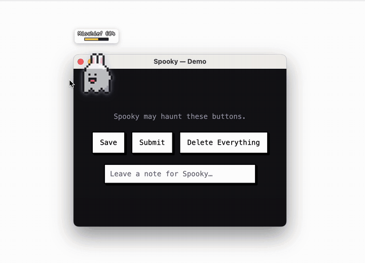

# Spooky: a desktop ghost whose pranks are picked by a local model

_Draft for the DEV Hacktoberfest 2026 Week 4 · Ghost in the Machine template. Not submitted._

## What I Built

Spooky is a 64px pixel ghost that lives on the macOS desktop. It follows the cursor at a short distance and fills a mischief gauge over 20 seconds. When the gauge is full, a local open-weight model ([Qwen3 1.7B](https://ollama.com/library/qwen3) via Ollama) picks one action:

- **BOO**: a synthesized ghost sound (5 patterns, Web Audio, no audio files)
- **EXPLODE**: the ghost flies to a target and blows it up, with a short line in a curious-kid voice

Targets are buttons and an input in Spooky's own demo window. Exploded buttons stay broken until you hit Rebuild. With macOS Accessibility turned on, the element nearest the cursor in other apps becomes a target too. Spooky only draws an explosion over that element and reads its label aloud. It never clicks or changes it.

## Demo

The ghost follows the cursor, fills its gauge every 5 seconds (demo setting) and lets the model pick: BOO, or EXPLODE on a button or the note input. Broken buttons stay broken until Rebuild.

## Code

<!-- TODO: link once the repo is public: https://github.com/dusunax/spooky -->

Electron + React + TypeScript, MIT.

## How I Built It

- **One call, one decision.** When the gauge is full, the main process sends a small context to Ollama: cursor speed bucket, distance, last action, current targets. `think` is off and temperature is 0.8. Median latency is 586 ms.
- **The schema does the safety work.** The model answers `{ choice, intensity, line }`. `choice` is a JSON-schema `enum` built per call from `"BOO"` and `"EXPLODE:<id>"` for each live target, so the model cannot name a target that doesn't exist. Zod checks the answer again.
- **Small-model fixes from measurement.**
  - With separate `type` and `targetId` fields, qwen3:1.7b picked BOO 0.5 in 12 of 12 runs. With one `choice` field it gave 16 of 16 valid answers, 9 BOO and 7 EXPLODE.
  - It picks whatever comes first in the list, even when the list is shuffled. So targets are sorted nearest to the cursor first, with each distance in pixels. On the same 100 distance sets, it picked the nearest target 22% of the time before (about chance) and 63% after.
  - It copied example lines word for word, so the prompt has none.
- **Honest records.** Every decision is logged with `source: 'model' | 'fallback'`. If Ollama is unreachable, the ghost stops pranking and shows `AI offline` instead of faking a choice.
- **Reading other apps without touching them.** A small Swift helper uses the Accessibility API to read the role, label and frame of the nearest element within 120 px. It skips password fields and never reads typed values. Labels go only to the local model and are redacted in logs.

## Why open innovation matters

Spooky watches what's near your cursor. Sending that to a hosted API for a prank would be a bad trade. With open weights and local inference, the labels never leave the machine and there's no API key or bill. The model can also be swapped with one env var (`SPOOKY_MODEL`). The decision code sits behind a small engine interface, so another local runtime can plug in without touching the safety checks.

## My Agent Session (optional)

I built Spooky with Claude Code. I decided the scope and the open questions. The agent wrote the code, measured the candidate models and pixel-drew the sprites from my reference sheet and overdraws.

## The Spirit of It (optional)

A ghost in the machine should be a little annoying and a little cute, and it should be honest about who is pulling the strings. Here it's a 1.7B model on your own laptop.
